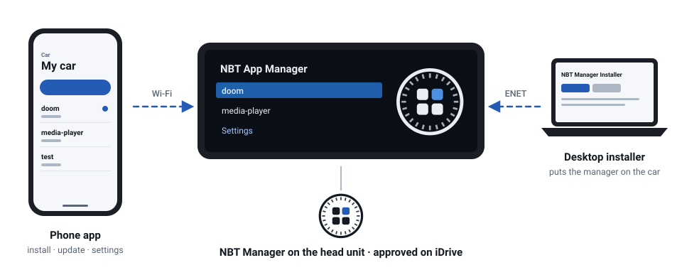
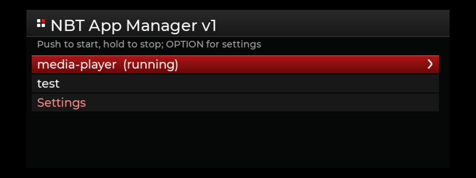
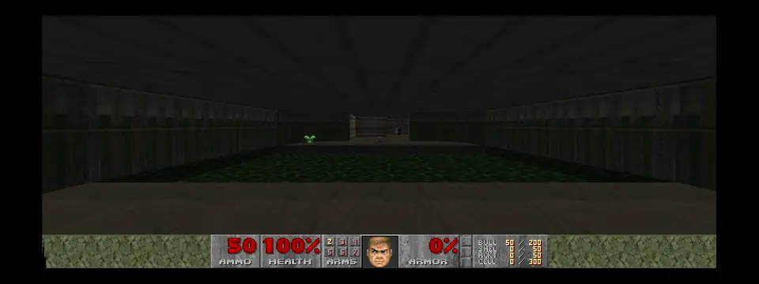
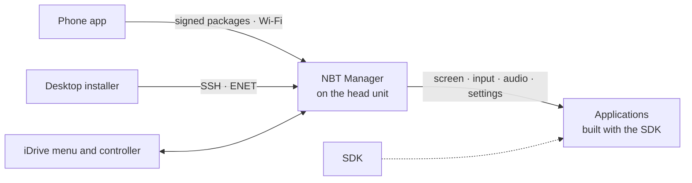

  <picture>
    <source media="(prefers-color-scheme: dark)" srcset="assets/logo-dark.svg">
    
  </picture>

  <b>Applications for BMW NBT Evo head units, installed from your phone.</b>

  <picture>
    <source media="(prefers-color-scheme: dark)" srcset="assets/hero-dark.svg">
    
  </picture>

NBTFoundry turns the iDrive 6 screen into a small application platform. NBT
Manager runs on the head unit and adds an entry to the iDrive menu; applications
start from it, get the screen, the controller and the car's audio, and hand them
back when they close. A paired phone installs, updates and configures them, and
every change is approved by the driver on the car.

**Supported head units:** BMW NBT Evo (iDrive 6). Support for the earlier NBT may
come later.

### What you can do

- **Install from your phone.** Pair once with a code on the car's screen, then
  send applications and updates over the car's Wi-Fi. The car checks each
  package's signature and the driver confirms it on iDrive.
- **Stay safe from bad updates.** A new version must start and stay healthy;
  otherwise the previous one comes back by itself.
- **Use the car's own controls.** Applications read the iDrive controller and a
  wired USB gamepad, and change their settings live from the phone.
- **Write your own.** The C++ SDK gives an application the screen (OpenGL ES 2),
  audio, input and the manager's lifecycle, and builds the same code for a Linux
  desktop.
- **Play Doom on the dashboard.** The shareware episode, as the example
  application.

<table>
  <tr>
    <td width="56%" align="center"> 
      On the car: review, install, health check</td>
    <td width="22%" align="center"> 
      On the phone</td>
    <td width="22%" align="center"> 
      Doom, the example application</td>
  </tr>
</table>

### Projects

| Repository | What it is |
| --- | --- |
| [manager](https://github.com/NBTFoundry/manager) | NBT Manager, on the head unit: the iDrive menu entry, the manager's screen, signed installs and updates with rollback, the application bridge |
| [mobile-app](https://github.com/NBTFoundry/mobile-app) | The Android app: pairing, the package library, installs, updates, settings and logs |
| [installer](https://github.com/NBTFoundry/installer) | The desktop installer: puts NBT Manager on the car over the ENET cable, updates it, collects diagnostics |
| [sdk](https://github.com/NBTFoundry/sdk) | The C++11 SDK for applications: lifecycle, display, audio, controller and gamepad input |
| [doom](https://github.com/NBTFoundry/doom) | PrBoom+ on the head unit, built on the SDK |

### How the pieces fit

### Safety

Use applications only while parked. Changing the software of a head unit is at
your own risk: it can affect the car's systems and its warranty.

---

Not affiliated with or endorsed by BMW AG. BMW, iDrive and NBT are trademarks of
BMW AG. DOOM is a trademark of id Software.
