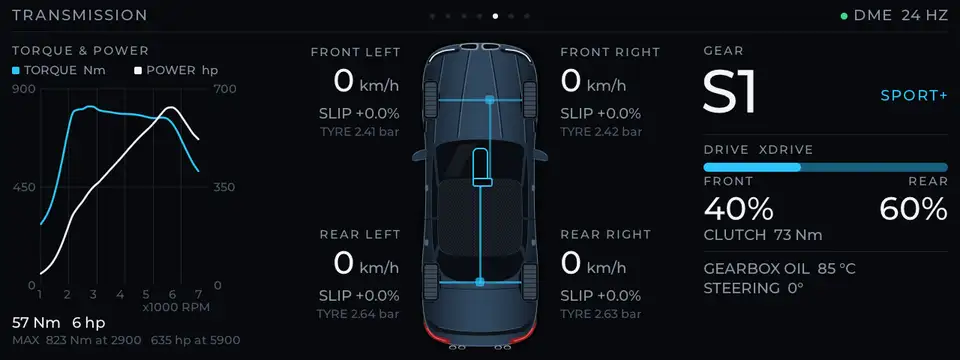
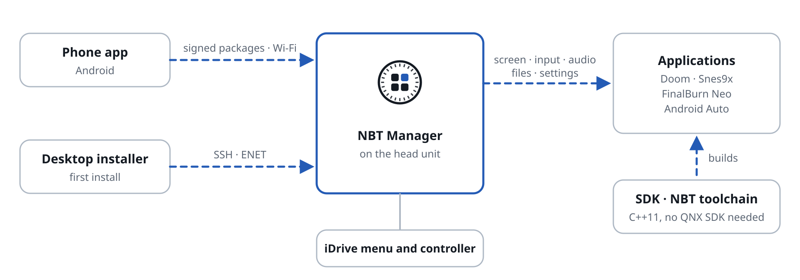

<!-- SPDX-License-Identifier: MPL-2.0 -->

  <picture>
    <source media="(prefers-color-scheme: dark)" srcset="https://raw.githubusercontent.com/NBTFoundry/.github/main/profile/assets/logo-dark.png">
    
  </picture>

  <b>New apps for your iDrive screen:</b> Android Auto, live engine gauges, fault codes, classic games. 
  Installed from your phone, approved on the car. And the tools to write your own. 
  For BMW, MINI and the Toyota GR Supra with iDrive 6.

  <a href="https://nbtfoundry.github.io"><b>Website</b></a> ·
  <a href="https://nbtfoundry.github.io/#car">Will it work on my car?</a> ·
  <a href="https://nbtfoundry.github.io/#start">Get started</a> ·
  <a href="https://nbtfoundry.github.io/#faq">FAQ</a> ·
  <a href="https://github.com/orgs/NBTFoundry/discussions">Discussions</a>

   
  Gauges on the head unit's screen (simulated readings)

<table>
  <tr>
    <td width="56%" align="center"> 
      On the car: review, install, health check</td>
    <td width="22%" align="center"> 
      On the phone</td>
    <td width="22%" align="center"> 
      Doom on the head unit</td>
  </tr>
</table>

NBT Manager runs on the head unit and hosts applications: it gives them the
screen, the iDrive controller, gamepads, the speakers and car data, and brings
back the last good version when an update fails. Drivers install apps from a
paired Android phone; developers write them in C++ with the SDK. Its screen
takes the car's look, as a BMW, a MINI or a Supra shows iDrive, and the phone
app follows.

**Supported:** BMW NBT Evo head units with iDrive 6 (the home screen of large
tiles), in BMWs, MINIs and the Toyota GR Supra. Not yet run on a Supra:
[owners, tell us how it goes](https://github.com/orgs/NBTFoundry/discussions/1).
**Status:** early.
[NBT Manager 0.5.2](https://github.com/NBTFoundry/manager/releases/tag/v0.5.2) is released, the
[desktop installer 0.1.1](https://github.com/NBTFoundry/installer/releases/tag/v0.1.1)
is a pre-release; the phone app is on Google Play in closed testing, open to anyone:
[join the test](https://nbtfoundry.github.io/beta.html) or [build it from source](https://github.com/NBTFoundry/mobile-app).

### Applications

Android Auto, live gauges, fault codes, Doom and four console and arcade emulators:
[see them all](https://nbtfoundry.github.io/#apps), with their releases.

### For developers

- **Apps in minutes.** Open the [template](https://github.com/NBTFoundry/template),
  start your coding agent and tell it what you want on the screen: the SDK ships
  the [skills](https://github.com/NBTFoundry/sdk/blob/main/docs/porting.md) that
  teach it the API, the car's controls and packaging. Doom and four emulators
  reached the car this way.
- **Desktop first.** The same C++ code runs on a Linux desktop and builds for the
  car with a free compiler for Linux, macOS and Windows.
- **Publish it.** Open a pull request on
  [community-apps](https://github.com/NBTFoundry/community-apps): we build your
  application from its source, sign it and list it in Get apps.

| Repository | What it is |
| --- | --- |
| [manager](https://github.com/NBTFoundry/manager) | NBT Manager, on the head unit: the iDrive menu entry, signed installs and updates with rollback, the application bridge |
| [mobile-app](https://github.com/NBTFoundry/mobile-app) | The Android app: pairing, Get apps, installs, updates, settings, files and logs |
| [installer](https://github.com/NBTFoundry/installer) | The desktop installer: puts NBT Manager on the car over the ENET cable |
| [sdk](https://github.com/NBTFoundry/sdk) | The C++ SDK: display, audio, input, files, a front end and a libretro host for emulators |
| [template](https://github.com/NBTFoundry/template), [examples](https://github.com/NBTFoundry/examples) | A bare application to start from; controls, settings and an LVGL interface |
| [toolchains](https://github.com/NBTFoundry/toolchains) | The NBT toolchain: Clang and LLD with the runtime applications link |
| [community-apps](https://github.com/NBTFoundry/community-apps) | Third-party applications, built and signed here |

  <picture>
    <source media="(prefers-color-scheme: dark)" srcset="https://raw.githubusercontent.com/NBTFoundry/.github/main/profile/assets/pieces-dark.png">
    
  </picture>

### Coming soon

- **Public on Google Play.** The phone app for everyone. It is in [closed testing](https://nbtfoundry.github.io/beta.html) today.
- **Phone companions.** An app can bring its own screen to the phone app.
- **Your own key.** Sign an app with your own key and run your builds on your car.

### Support

If NBTFoundry is useful to you, you can support its development on
[GitHub Sponsors](https://github.com/sponsors/fpoussin) or
[Ko-fi](https://ko-fi.com/fpoussin). Donations are optional and buy nothing:
every application stays free.

  
  

### Safety

> **Warning: installing or modifying this software can brick your head unit. Recovery may require professional service or replacement, at your expense. Provided AS IS; use at your own risk, subject to applicable law.** [Read the risk and liability disclaimer](https://github.com/NBTFoundry/.github/blob/main/DISCLAIMER.md).

Use applications only while parked. Changing the software of a head unit is at
your own risk: it can affect the car's systems and its warranty.

---

Not affiliated with or endorsed by BMW AG, Toyota Motor Corporation or any other
trademark owner named here. BMW, MINI, iDrive and NBT are trademarks of BMW AG; Toyota and
Supra of Toyota Motor Corporation; DOOM of id Software; Android, Android Auto and
Google Play of Google LLC; QNX of BlackBerry Limited.

## License

Copyright (c) 2026 Fabien Poussin. **MPL-2.0** ([LICENSE](https://github.com/NBTFoundry/.github/blob/main/LICENSE)), logos, artwork and screenshots included; third-party parts keep their own terms ([notices](https://github.com/NBTFoundry/.github/blob/main/legal/README.md)). No trademark rights are granted.
