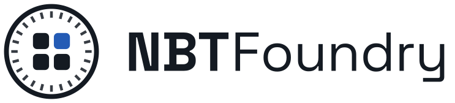
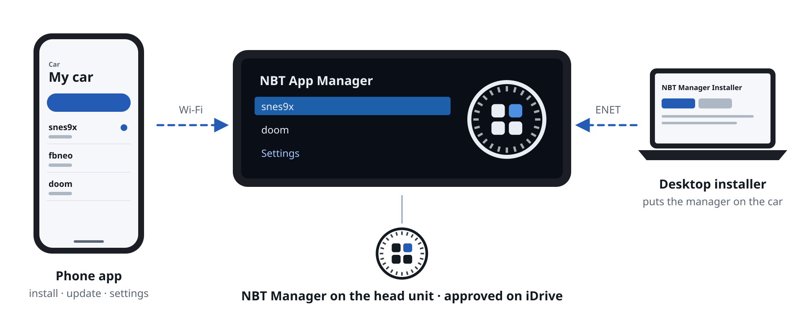
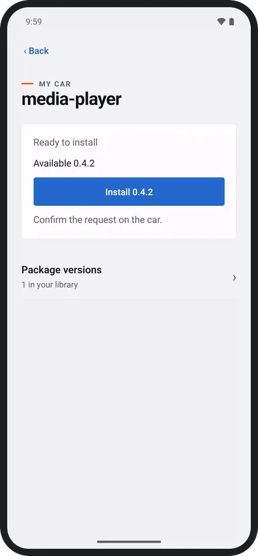

<!-- SPDX-License-Identifier: MPL-2.0 -->

  <picture>
    <source media="(prefers-color-scheme: dark)" srcset="https://raw.githubusercontent.com/NBTFoundry/.github/main/profile/assets/logo-dark.png">
    
  </picture>

  <b>Applications for BMW NBT Evo head units, installed from your phone.</b>

  <picture>
    <source media="(prefers-color-scheme: dark)" srcset="https://raw.githubusercontent.com/NBTFoundry/.github/main/profile/assets/hero-dark.png">
    
  </picture>

NBTFoundry turns the iDrive 6 screen into a small application platform. NBT
Manager runs on the head unit and adds an entry to the iDrive menu; applications
start from it, get the screen, the controller and the car's audio, and hand them
back when they close. A paired phone installs, updates and configures them, and
every change is approved by the driver on the car.

**Supported head units:** BMW NBT Evo (iDrive 6). Support for the earlier NBT may
come later.

**Status:** early. [NBT Manager 0.3.1](https://github.com/NBTFoundry/manager/releases/tag/v0.3.1)
is a pre-release; the phone app and the desktop installer have no binary release
yet and are built from source.

### What you can do

- **Install from your phone.** Pair once with a code on the car's screen, then
  send applications and updates over the car's Wi-Fi. The car checks each
  package's signature and the driver confirms it on iDrive.
- **Stay safe from bad updates.** A new version must start and stay healthy;
  otherwise the previous one comes back by itself. An application too old for
  the installed manager stays disabled until it is updated, instead of crashing.
- **Bring your own games and files.** Send them from the phone, or plug a USB
  stick into the car and import them; they are kept on the head unit's hard disk.
- **Use the car's own controls.** Applications read the iDrive controller and a
  wired USB gamepad, play through the car's speakers, and change their settings
  live from the phone.
- **Start with the car.** An application can start by itself when the head unit
  boots.
- **In your language.** English, French, German, Italian, Spanish, Chinese and
  Japanese; the manager follows iDrive's language.
- **Write your own.** The C++ SDK gives an application the screen (OpenGL ES 2),
  audio, input, files and the manager's lifecycle, and builds the same code for a
  Linux desktop. A front end and a libretro host turn an emulator core into an
  application. The NBT toolchain, prebuilt for Linux, macOS and Windows, compiles
  it for the car with open-source tools only, without the QNX SDK.

<table>
  <tr>
    <td width="56%" align="center"> 
      On the car: review, install, health check</td>
    <td width="22%" align="center"> 
      On the phone</td>
    <td width="22%" align="center"> 
      Doom on the head unit</td>
  </tr>
</table>

### Applications

| Application | What it is | State | License |
| --- | --- | --- | --- |
| [nf-doom](https://github.com/NBTFoundry/nf-doom) | Doom (PrBoom+), with the shareware episode | [1.0.21](https://github.com/NBTFoundry/nf-doom/releases/tag/v1.0.21) | GPL-2.0-or-later; game data separate |
| [nf-snes9x](https://github.com/NBTFoundry/nf-snes9x) | Snes9x: Super Nintendo games you own, from the phone or a USB stick | [1.63.1](https://github.com/NBTFoundry/nf-snes9x/releases/tag/v1.63.1) | MPL-2.0; Snes9x non-commercial |
| [nf-fbneo](https://github.com/NBTFoundry/nf-fbneo) | FinalBurn Neo: arcade games from zipped romsets | Car testing | MPL-2.0; FinalBurn Neo non-commercial |
| [nf-pcsx-rearmed](https://github.com/NBTFoundry/nf-pcsx-rearmed) | PCSX ReARMed: PlayStation games you own, from a USB stick | Car testing | GPL-2.0-or-later |
| [nf-picodrive](https://github.com/NBTFoundry/nf-picodrive) | PicoDrive: Mega Drive, Mega-CD, 32X and Master System games you own | Car testing | MPL-2.0; PicoDrive non-commercial |
| [nf-android-auto](https://github.com/NBTFoundry/nf-android-auto) | Android Auto: [NBT-AAD](https://github.com/Sq00ky/Supra-iDrive6-Android-Auto), installed and updated like any application | Test build | MPL-2.0; NBT-AAD PolyForm Noncommercial 1.0.0 |

Apart from Doom's shareware episode, no game, ROM or BIOS is included: use only
games you have the right to use.

### Projects

| Repository | What it is | License |
| --- | --- | --- |
| [manager](https://github.com/NBTFoundry/manager) | NBT Manager, on the head unit: the iDrive menu entry, the manager's screen, signed installs and updates with rollback, the application bridge | MPL-2.0 |
| [mobile-app](https://github.com/NBTFoundry/mobile-app) | The Android app: pairing, the package library, installs, updates, settings, files and logs | MPL-2.0 |
| [installer](https://github.com/NBTFoundry/installer) | The desktop installer: puts NBT Manager on the car over the ENET cable, updates it, collects diagnostics | GPL-3.0-or-later; shared core/bindings MPL-2.0 |
| [sdk](https://github.com/NBTFoundry/sdk) | The C++11 SDK for applications: lifecycle, display, audio, controller and gamepad input, files, a reusable front end and a libretro host for emulators | MPL-2.0 |
| [toolchains](https://github.com/NBTFoundry/toolchains) | The NBT toolchain: Clang and LLD with the runtime applications link (picolibc, libc++), released for Linux, macOS and Windows | MPL-2.0; LLVM and picolibc under their own licenses |

### How the pieces fit

  <picture>
    <source media="(prefers-color-scheme: dark)" srcset="https://raw.githubusercontent.com/NBTFoundry/.github/main/profile/assets/pieces-dark.png">
    
  </picture>

### Support

If NBTFoundry is useful to you, you can support its development on
[GitHub Sponsors](https://github.com/sponsors/fpoussin) or
[Ko-fi](https://ko-fi.com/fpoussin). Donations are optional and buy nothing:
every application stays free.

### Safety

> **Warning: installing or modifying this software can brick your head unit. Recovery may require professional service or replacement, at your expense. Provided AS IS; use at your own risk, subject to applicable law.** [Read the risk and liability disclaimer](https://github.com/NBTFoundry/.github/blob/main/DISCLAIMER.md).

Use applications only while parked. Changing the software of a head unit is at
your own risk: it can affect the car's systems and its warranty.

---

Not affiliated with or endorsed by BMW AG or any other trademark owner named here.
BMW, iDrive and NBT are trademarks of BMW AG; DOOM of id Software; Super Nintendo of
Nintendo; PlayStation of Sony Interactive Entertainment Inc.; Android Auto of Google LLC;
QNX of BlackBerry Limited.

## License

Copyright (c) 2026 Fabien Poussin. Original code, tests, build scripts and documentation are licensed under **MPL-2.0**; see [LICENSE](https://github.com/NBTFoundry/.github/blob/main/LICENSE).

Original NBTFoundry logos, artwork and screenshots are under **MPL-2.0**, including copies in other NBTFoundry repositories. Third-party code, fonts, game data and their notices retain their own terms. Copyright permission for artwork does not grant trademark rights or imply endorsement by BMW AG or any other trademark owner.

See [legal/README.md](https://github.com/NBTFoundry/.github/blob/main/legal/README.md) for third-party license notices.
